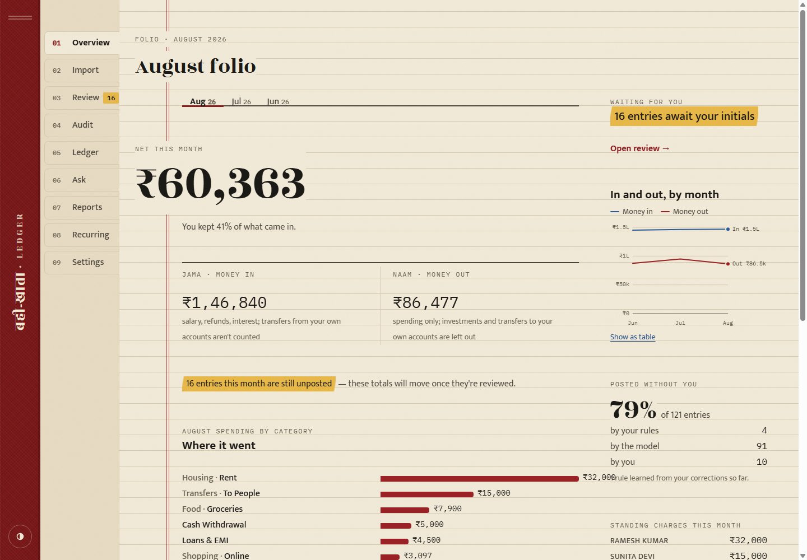
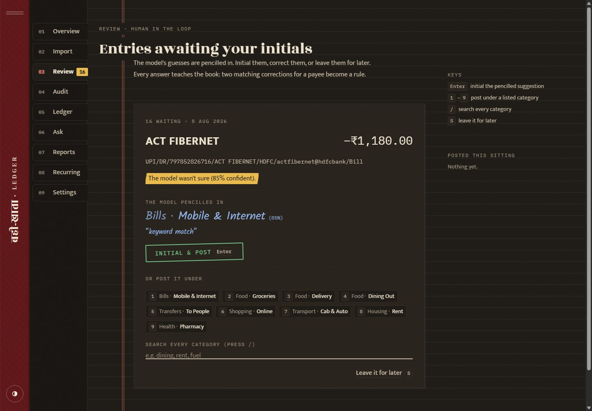
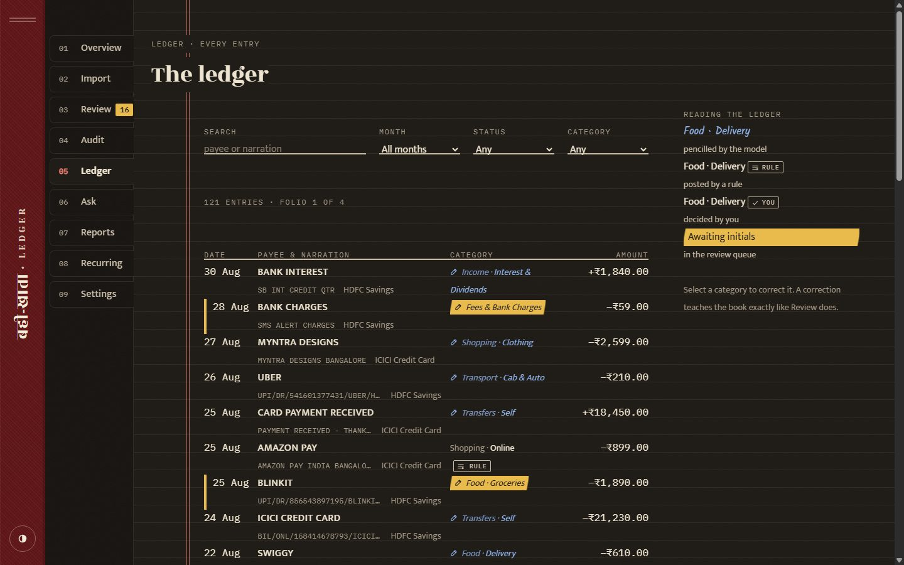

# Ledger Agent

**An AI bookkeeper for messy Indian bank statements.** Import CSV exports from any bank or card. It
learns the file format, categorizes every transaction, learns from your corrections until it barely
needs the model, catches its own confident mistakes, reconciles balances, finds subscriptions and price
hikes, writes a monthly report whose numbers are checked, and answers questions like *"how much did we
spend eating out in July?"*

It's the capstone of a ten-project course on agent harness engineering (the loop, the harness, context,
memory, long-horizon runs, multi-agent, evals): every idea from those projects, P01-P10, applied to one
real problem, with the
production concerns that tutorials usually skip (money correctness, idempotency, budgets, privacy,
prompt injection, audit logs, evals in CI). **One process serves both the web app and its REST API.**



| Review: the model's guess in blue pencil, one keystroke to initial it | The ledger: who decided each category is always visible |
|---|---|
|  |  |

```
statement.csv ─▶ read & find table ─▶ learn/reuse import profile ─▶ parse + validate ─▶ dedupe ─▶ SQLite
                                        (procedural memory)          (balance sensor)
pending txns ─▶ injection tripwire ─▶ rules ─▶ LLM (structured, few-shot from verified labels) ─▶ sensors
                   │                   │ 0 tokens        │ confidence ≥ 0.8 and direction ok
                   ▼                   ▼                 ▼
               human review ◀── low confidence / flags   categorized ──▶ audit sample (spot-check) ──▶ human
                   │
                   └─▶ correction ─▶ verified label ─▶ few-shot example ─▶ compiled rule ─▶ propagates
```

## Why this problem

- **Real and universal.** UPI narrations look like `UPI/DR/412345678901/RAMESH KUMAR/SBIN/ramesh.kumar@oksbi/rent`.
  Every bank exports a different CSV layout. Nobody categorizes by hand for long.
- **Correctness is checkable.** Balances must reconcile to the paisa, which gives you hard sensors
  that most agent demos lack.
- **The model is the least trusted component.** It proposes; deterministic code, verified memory and
  humans decide. That's harness engineering in its clearest form.
- **Memory has measurable value.** Human workload goes down month over month, and the evals show it.

## Quickstart

**See the app in two minutes (no API key needed):**

```powershell
cd ledger-agent
python -m venv .venv; .venv\Scripts\Activate.ps1
pip install -e ".[dev]"
cd ui; npm install; npm run build; cd ..       # builds the web UI into the package
python scripts/seed_demo_db.py data/demo.db    # 3 months, 2 accounts, categorised offline
$env:LEDGER_DB_PATH = "data/demo.db"
ledger serve                                   # open http://127.0.0.1:8000
```

**Use it for real (OpenAI):**

```powershell
$env:OPENAI_API_KEY = "sk-..."
Remove-Item Env:LEDGER_DB_PATH                 # back to your own ledger at data/ledger.db
ledger serve                                   # then: Import → Review → Overview → Ask
```

Everything in the UI is also available from the terminal (`ledger import`, `process`, `review`, `audit`, `ask`,
`report`, `subs`, `stats`), and over HTTP (docs at `/docs`).

**Check it:**

```powershell
pytest                                         # backend: 93 tests, offline
python evals/run_evals.py --fake               # offline eval: learning curve, safety, grounding
cd ui; npm run typecheck; npm test             # frontend: strict TS + 37 tests
```

## The web app

A designed interface, not a dashboard kit: the app is laid out like a *bahi-khata*, the red account book
Indian traders keep (see [DESIGN.md](DESIGN.md) for the approved design system and [ui/README.md](ui/README.md)
for the code). The trust model of the backend is visible in the interface:

| On screen | Means |
|---|---|
| *blue pencil handwriting* | the model's suggestion, not yet in the books |
| black ink + **RULE** stamp | posted by a deterministic rule (learned from you, or written by you) |
| black ink + **✓ YOU** | your decision, the ground truth |
| haldi (turmeric) highlighter | needs your attention |
| green **RECONCILED** stamp | the statement's running balance checked out to the paisa |

| Page | What it's for |
|---|---|
| **Overview** | the month's folio: net figure, *Jama · Naam* (in · out), where it went, trend, what's waiting |
| **Import** | drop CSVs; each comes back as a receipt with new / duplicate / rejected rows and the balance stamp |
| **Review** | one entry at a time. `Enter` initials the suggestion, `1`–`9` quick categories, `/` search, `S` skip |
| **Audit** | spot-check the model's *confident* answers (the only way to catch silent errors) |
| **Ledger** | every entry, filterable; correct any category in place (it teaches the book like Review does) |
| **Ask** | "Ask the munim": questions answered by the tool-using agent, with the tools it consulted as footnotes |
| **Reports** | the monthly folio; every figure is verified against the books, and invented ones are struck from the record |
| **Recurring** | subscriptions, EMIs, rent; price rises flagged |
| **Settings** | memory blocks, remembered facts, rules, the access key, model usage |

Day and lamplit (dark) themes, keyboard-first review, screen-reader labels on amounts and charts, reduced
motion respected, and it works down to 390px wide.

## Commands

| Command | What it does |
|---|---|
| `ledger import FILE... --account NAME` | read, learn or reuse the format profile, validate (parse rate + running balance), dedupe, store |
| `ledger process [--resume RUN] [--limit N]` | run the categorization cascade in checkpointed batches under a token budget |
| `ledger review` | human review queue (low confidence, sensor flags, suspicious text, errors) |
| `ledger audit [--n 5]` | spot-check confident model answers: the only way to catch silent errors |
| `ledger ask ["question"]` | Q&A agent (tools + read-only SQL sandbox + memory); no question = chat |
| `ledger report YYYY-MM [--out f.md]` | monthly report: SQL facts + LLM narrative + number verifier |
| `ledger rules [--add 'ZOMATO=Food:Delivery']` | list/add deterministic rules (user rules outrank compiled ones) |
| `ledger subs` | recurring payments, monthly cost, price changes, next expected date |
| `ledger memory [--set 'block=text']` | view/edit pinned memory (household / preferences / goals) and facts |
| `ledger stats` | automation rate, review backlog, rules, LLM calls/tokens/cost by purpose, recent runs |
| `ledger demo` / `ledger serve` | sample statements / the web app + HTTP API |

HTTP API (interactive docs at `/docs`): `POST /v1/imports`, `POST /v1/process`, `GET /v1/review`, `GET /v1/audit`,
`POST /v1/transactions/{id}/category|accept`, `GET /v1/transactions`, `GET|POST|DELETE /v1/rules`, `POST /v1/chat`,
`GET /v1/conversations/{id}`, `GET /v1/reports/{month}?format=md`, `GET /v1/facts/{month}`, `GET /v1/trend`,
`GET /v1/months`, `GET /v1/accounts`, `GET /v1/categories`, `GET /v1/subscriptions`, `GET|PUT /v1/memory/blocks[/{label}]`,
`GET|DELETE /v1/memory/facts[/{id}]`, `GET /v1/stats`, `GET /healthz`. Set `LEDGER_API_KEY` to require a bearer token.

## Measured (offline keyword model, `python evals/run_evals.py --fake`)

| month | automation | auto accuracy | silent errors | human reviews + audits | rule / model |
|---|---:|---:|---:|---:|---:|
| 2026-06 | 77% | 90% | 7.7% | 10 + 5 | 0 / 30 |
| 2026-07 | 98% | 100% | 0.0% | 1 + 5 | 4 / 37 |
| 2026-08 | 100% | 100% | 0.0% | 0 + 5 | 6 / 34 |

Without audits (`--audit 0`), silent errors stay around 7.5% every month: the keyword model files
"THIRD WAVE CO**FFEE**" under *Fees* with high confidence, and no uncertainty-based queue ever surfaces
it. See [docs/THEORY.md §4](docs/THEORY.md). Run the same eval against OpenAI (drop `--fake`) to also
get Q&A pass@1 and pass^3.

## Configuration

Everything is an env var with the `LEDGER_` prefix (or a `.env` file); see `.env.example` and
`src/ledger_agent/config.py`. The most important ones: `OPENAI_API_KEY`, `LEDGER_MODEL_BULK`
(default `gpt-5.4-mini`), `LEDGER_MODEL_AGENT` (default `gpt-5.4`), `LEDGER_AUTO_ACCEPT_CONFIDENCE`
(0.80), `LEDGER_MAX_TOKENS_PER_RUN`, `LEDGER_PRICE_INPUT_PER_MTOK` / `..._OUTPUT_...` (enable $
tracking), and `LEDGER_API_KEY`.

## Documentation

| Doc | For |
|---|---|
| [DESIGN.md](DESIGN.md) · [docs/UI_DESIGN_PROTOCOL.md](docs/UI_DESIGN_PROTOCOL.md) · [ui/README.md](ui/README.md) | the approved design system; the UI rules behind it; the frontend code |
| [docs/ARCHITECTURE.md](docs/ARCHITECTURE.md) | components, data flow, schema, design decisions and rejected alternatives |
| [docs/THEORY.md](docs/THEORY.md) | the expert theory: cascades, calibration, silent errors, memory lifecycle, exactly-once, injection, grounding |
| [docs/CODE_WALKTHROUGH.md](docs/CODE_WALKTHROUGH.md) | a guided read of the code: trace one transaction and one question end to end |
| [docs/EVALS.md](docs/EVALS.md) | metrics, ablations, the CI gate, how to add eval tasks |
| [docs/OPERATIONS.md](docs/OPERATIONS.md) | deploy, monitor, runbooks, cost control, scaling path |
| [docs/SECURITY.md](docs/SECURITY.md) | threat model, data flows to the LLM provider, controls and known gaps |

## Where each course project shows up

P01-P10 are the course's projects, which the docs here refer to by number. The course itself lives
outside this repository; this table is the map from each idea to its code.

| Course project | In Ledger Agent |
|---|---|
| P01 loop | `agent/loop.py`: Responses-API tool loop |
| P02 harness | `llm/client.py` (retries, budgets, audit log, cache), `agent/tools.py` (strict schemas, errors as observations, truncation) |
| P03 tools/sensors | `agent/sql_guard.py` (sandbox), balance reconciliation, direction sensor, number verifier |
| P04 context | lean per-question context, history of answers only, old tool outputs cleared, stable-prefix prompts |
| P05 memory blocks | `memory.py` household / preferences / goals blocks, editable by the agent |
| P06 long-term memory | `memory.py` facts with BM25 + recency + importance recall; verified labels as episodic memory |
| P07 procedural memory | import profiles and compiled rules: skills learned once and reused for free |
| P08 long-horizon | `categorize/pipeline.py`: checkpointed, budgeted, resumable runs |
| P09 multi-agent | evaluator-optimizer for reports with a *code* evaluator; humans as the second agent |
| P10 evals | `evals/run_evals.py`: learning curves, ablations, safety checks, pass^k, CI regression gate |

## Limitations and roadmap

- CSV only. PDF statements need a table-extraction step before `read_table`.
- Single user, SQLite. The path to multi-user is in [OPERATIONS.md](docs/OPERATIONS.md#scaling-path).
- Keyword BM25 for fact recall. Swap in embeddings (`sqlite-vec`) once you have hundreds of facts.
- Split transactions (one payment, two categories) aren't modelled yet.
- The model's confidence isn't calibrated. The threshold is a knob you should tune with the eval (THEORY §3).
